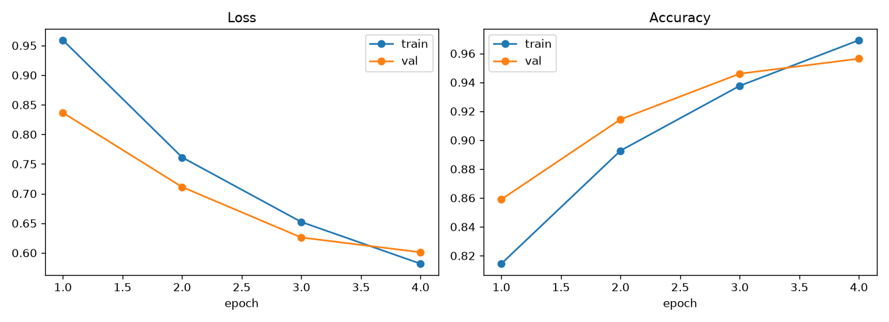
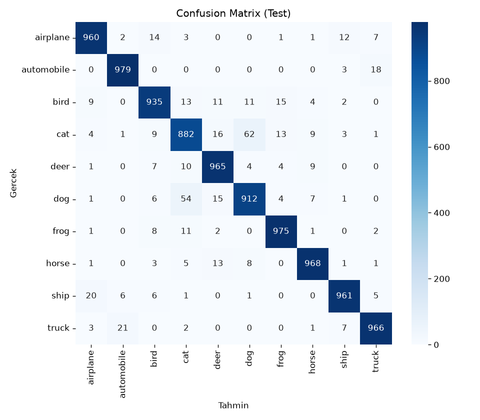
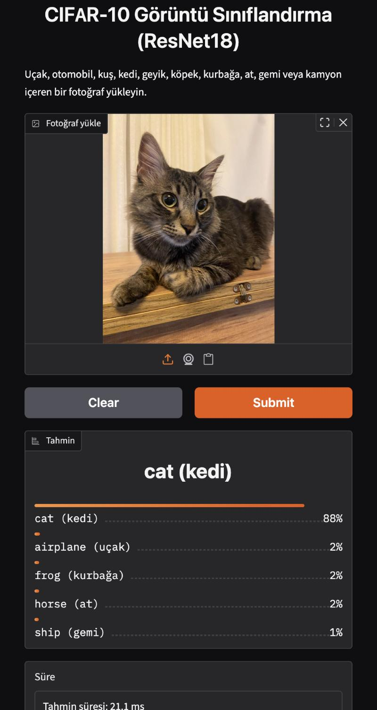
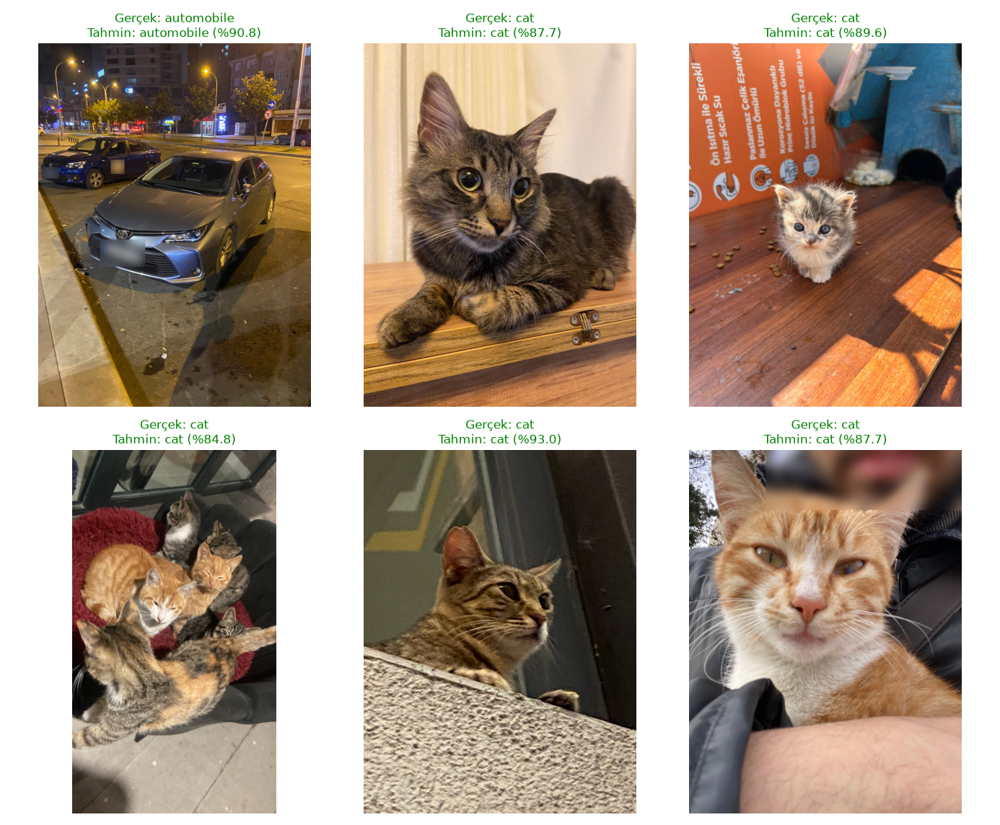
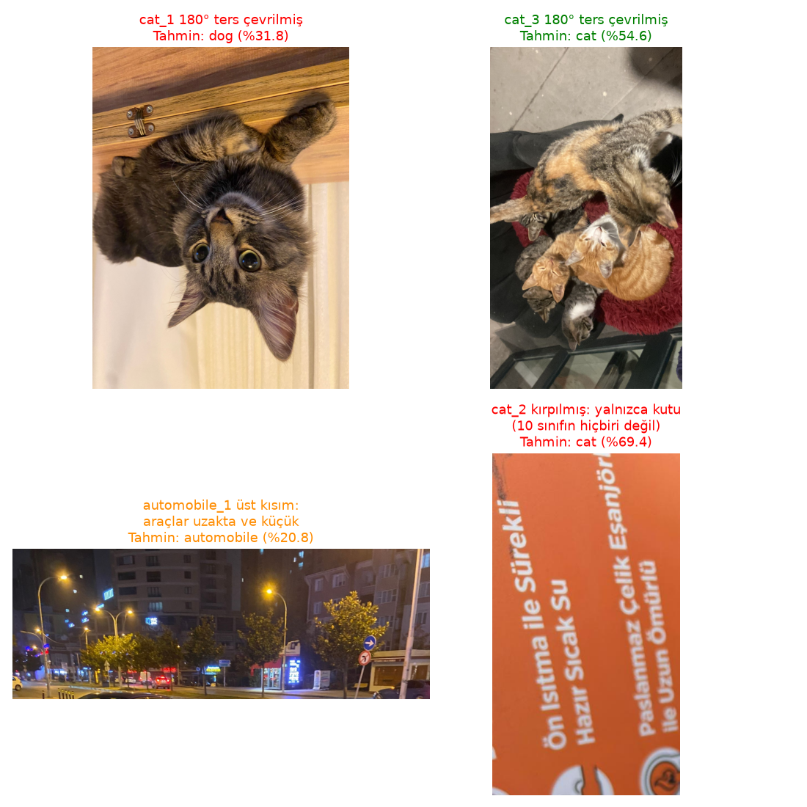

# CIFAR-10 Görüntü Sınıflandırma — ResNet18 Transfer Learning

**Amaç:** Açık kaynaklı CIFAR-10 veri seti ile bir görüntü sınıflandırma modeli geliştirmek, modelin başarımını uygun metriklerle değerlendirmek, modeli Gradio ile çalışan bir web uygulamasına dönüştürmek ve telefonla çekilmiş gerçek fotoğraflarla test etmek.

## 1. Proje Raporu Şablonu

| Alan | Açıklama / Öğrenci yanıtı |
|---|---|
| Project Title | CIFAR-10 Görüntü Sınıflandırma (ResNet18 Transfer Learning) |
| Problem / Task | Görüntü sınıflandırma (10 sınıf: uçak, otomobil, kuş, kedi, geyik, köpek, kurbağa, at, gemi, kamyon) |
| Dataset | CIFAR-10. 60.000 renkli görüntü, 32×32. Bölme: 45.000 eğitim / 5.000 doğrulama / 10.000 test |
| Dataset URL | https://www.cs.toronto.edu/~kriz/cifar.html |
| Model Architecture | ResNet18 (ImageNet ön-eğitimli, torchvision). Son katman 10 çıkışlı `Linear(512, 10)` ile değiştirildi, tüm ağ fine-tune edildi |
| Input Size | 3×128×128 (32×32 görüntüler bilinear ile 128×128'e büyütüldü) |
| Hyperparameters | LR = 1e-3 (OneCycleLR, %20 warm-up), batch size = 128, epoch = 4, weight decay = 0.05, label smoothing = 0.1, augmentation: random crop (pad 4) + yatay çevirme |
| Optimizer | AdamW |
| Activation / Output Function | Gizli katmanlarda ReLU, çıkışta Softmax |
| Loss Function | Cross-Entropy Loss (label smoothing 0.1) |
| Evaluation Metrics | Accuracy, Precision, Recall, F1-score (macro), Confusion Matrix |
| Training Environment | MacBook Apple M2, PyTorch 2.15 (MPS GPU backend), Python 3.12 |
| Best Performance | Test Accuracy %95.03, Precision %95.02, Recall %95.03, F1 %95.02 (en iyi doğrulama acc. %95.64) |
| Inference Time | Görüntü başına ~6.8 ms (M2 GPU, batch=1). Toplam eğitim süresi ~18.5 dk (1111 s) |
| Deployment Technology | Gradio (web arayüzü, `app.py`) |
| Repository | https://github.com/bursal0/cifar10-resnet18-classification |

## 2. Model Ayarları ve Seçimlerin Gerekçesi

- **ResNet18 + transfer learning:** ImageNet'te öğrenilmiş genel görsel özellikler (kenar, doku, şekil) küçük veri setinde hızlı yakınsama ve yüksek doğruluk sağlar. Residual bağlantılar derin ağın kararlı eğitilmesini sağlar. ResNet18 hem hızlı hem yeterince güçlü olduğu için seçildi.
- **128×128 giriş:** ResNet18 ImageNet'te 224 px ile eğitildi. 32 px'lik girdide ilk katmanlardaki downsampling uzaysal bilgiyi çok erken yok eder. 128 px, doğruluk ile hız arasında bir denge.
- **AdamW:** Adam'ın uyarlamalı öğrenme hızı ile hızlı yakınsar. Weight decay'i ayrık uyguladığı için düzenlileştirme (regularization) daha doğru çalışır.
- **OneCycleLR:** Önce ısınma, sonra kosinüs azalma. Az epoch'ta yüksek doğruluğa ulaşmayı sağlar.
- **Batch size 128:** GPU belleğine rahat sığar, gradyanlar yeterince kararlı.
- **4 epoch:** Ön-eğitimli model hızlı yakınsadığı için yeterli. Doğrulama doğruluğu her epoch'ta arttı, overfitting gözlenmedi.
- **Softmax + Cross-Entropy:** Çok sınıflı tek etiketli sınıflandırma için standart seçim. Label smoothing aşırı özgüveni azaltır ve gerçek fotoğraflarda genellemeye yardımcı olur.
- **Augmentation:** Random crop ve yatay çevirme ile modelin konum ve yön değişimlerine karşı dayanıklılığı artırıldı.

## 3. Eğitim Süreci

| Epoch | Train Loss | Train Acc | Val Loss | Val Acc | Süre |
|---|---|---|---|---|---|
| 1 | 0.959 | %81.4 | 0.837 | %85.9 | 256 s |
| 2 | 0.761 | %89.3 | 0.711 | %91.4 | 254 s |
| 3 | 0.652 | %93.8 | 0.626 | %94.6 | 279 s |
| 4 | 0.582 | %96.9 | 0.601 | %95.6 | ~322 s |

(Kesin değerler: `outputs/metrics.json`. Not: label smoothing kullanıldığı için loss değerleri 0'a yaklaşmaz.)



## 4. Test Performansı

| Sınıf | Precision (%) | Recall (%) | F1 (%) |
|---|---|---|---|
| airplane | 96.00 | 96.00 | 96.00 |
| automobile | 97.03 | 97.90 | 97.46 |
| bird | 94.64 | 93.50 | 94.06 |
| cat | 89.91 | 88.20 | 89.05 |
| deer | 94.42 | 96.50 | 95.45 |
| dog | 91.38 | 91.20 | 91.29 |
| frog | 96.34 | 97.50 | 96.92 |
| horse | 96.80 | 96.80 | 96.80 |
| ship | 97.07 | 96.10 | 96.58 |
| truck | 96.60 | 96.60 | 96.60 |

- **Accuracy:** %95.03
- **Macro Precision / Recall / F1:** %95.02 / %95.03 / %95.02
- En zor sınıf **kedi** (F1 ≈ %89), ardından **köpek** (F1 ≈ %91). Bu iki sınıf karışıklık matrisinde en çok birbirine karışan çifttir. 32×32 çözünürlükte kedi ve köpek siluetleri çok benzer.
- En kolay sınıflar kurbağa, at, kamyon ve gemi (F1 ≈ %97). Bunların renk ve arka planları (su, yol) ayırt edicidir.



**Süreler:** Eğitim ~1111 s (≈18.5 dk, 4 epoch, Apple M2 GPU). Tahmin ~6.8 ms/görüntü.

## 5. Uygulama (Deployment)

`app.py` ile bir Gradio web arayüzü oluşturuldu. Kullanıcı bilgisayardan fotoğraf yükleyebilir, webcam ile çekebilir ya da panodan yapıştırabilir. Telefon fotoğrafları da hazır örnek olarak arayüzde bulunur. "Submit" butonuna basıldığında uygulama en olası 5 sınıfı olasılıklarıyla birlikte ve tahmin süresini gösterir. Uygulamada, telefon fotoğrafı için ön işleme dahil ölçülen tahmin süresi ~21 ms'dir.

Uygulamanın çalışırken alınmış ekran görüntüsü (telefon fotoğrafı cat_1 → %88 kedi):



```bash
.venv/bin/python app.py   # http://127.0.0.1:7860
```

## 6. Gerçek (Telefon) Görüntüleriyle Test

Telefonla 6 fotoğraf çekildi: 1 otomobil ve 5 kedi. Gizlilik için araç plakaları ve kadrajdaki insan yüzü bulanıklaştırıldı. Sonuçlar bulanıklaştırılmış fotoğraflarla alındı. Kedi fotoğrafları bilerek farklı koşullarda seçildi: yavru kedi, kalabalık grup, düşük ışık/bulanık çekim ve yüze çok yakın çekim. Fotoğraflar `test_phone_photos.py` ile modele verildi.



| Fotoğraf | Koşul | Gerçek | Tahmin (güven) | 2. tahmin | Sonuç |
|---|---|---|---|---|---|
| automobile_1 | Gece, sokak lambası, arkada başka araçlar | otomobil | otomobil (%90.8) | köpek (%1.7) | Doğru |
| cat_1 | Gün ışığı, sade arka plan, net | kedi | kedi (%87.7) | uçak (%1.7) | Doğru |
| cat_2 | Yavru kedi, karmaşık arka plan (yazılı kutu, mama) | kedi | kedi (%89.6) | köpek (%1.6) | Doğru |
| cat_3 | Tek karede 6–7 kedi, flaşlı, üstten açı | kedi | kedi (%84.8) | köpek (%5.6) | Doğru |
| cat_4 | Düşük ışık, gren/bulanıklık, alttan açı | kedi | kedi (%93.0) | kurbağa (%1.2) | Doğru |
| cat_5 | Çok yakın çekim, kadrajda insan da var | kedi | kedi (%87.7) | uçak (%2.0) | Doğru |

**Doğruluk: 6/6 (%100). Ortalama güven: %88.9.**

### Başarısız Durum Analizi (zorlaştırılmış varyasyonlar)

Orijinal 6 fotoğrafın hepsi doğru sınıflandırıldı. Bu nedenle modelin hangi koşullarda başarısız olduğunu göstermek için aynı telefon fotoğraflarından zorlaştırılmış varyasyonlar üretildi (`test_failure_cases.py`): ters çevirme, nesnenin çok küçük kaldığı kırpma ve 10 sınıfın hiçbirine ait olmayan bir nesne.



| Varyasyon | Beklenen | Tahmin (güven) | 2. tahmin | Sonuç |
|---|---|---|---|---|
| cat_1 180° ters çevrilmiş | cat (kedi) | dog (köpek) (%31.8) | cat (kedi) (%29.6) | Yanlış |
| cat_3 180° ters çevrilmiş | cat (kedi) | cat (kedi) (%54.6) | dog (köpek) (%36.8) | Doğru (güven belirgin düştü) |
| automobile_1 üst kısım: araçlar uzakta ve küçük | automobile (otomobil) | automobile (otomobil) (%20.8) | airplane (uçak) (%18.5) | Kısmen (doğru ama düşük güven) |
| cat_2 kırpılmış: yalnızca kutu (10 sınıfın hiçbiri değil) | yok (sınıf dışı) | cat (kedi) (%69.4) | airplane (uçak) (%11.6) | Yanlış (kapsam dışı nesne, zorla bir sınıfa atandı) |

### Yorum

- **Başarılı olduğu durumlar:** Model 6 fotoğrafın hepsini doğru sınıflandırdı. Gece çekilmiş araba fotoğrafını da (arka planda başka araçlar ve tabelalar var) doğru tanıdı. Bulanık ve düşük ışıklı kedi fotoğrafında en yüksek güveni (%93.0) verdi. Bu durum, 32×32'ye küçültme işleminin gren ve bulanıklık gibi bozulmaları bastırmasıyla açıklanabilir: model zaten düşük çözünürlükte "genel şekil ve doku" ile karar veriyor.
- **Zorlandığı durumlar:**
  - **Kalabalık sahne (cat_3):** En düşük güven (%84.8) ve en yüksek ikinci olasılık (köpek %5.6) bu fotoğrafta çıktı. Model tek nesne içeren görüntülerle eğitildi. Birden fazla, iç içe geçmiş hayvan ve flaşın yarattığı renk bozulması kararsızlığı artırdı. Ayrıca **kedi ↔ köpek** karışıklığı test setinde de en sık görülen hataydı (kedi F1 ≈ %89).
  - **Karmaşık arka plan (cat_2, cat_5):** Yazılı turuncu kutu veya kadrajdaki insan yüzü modeli yanıltmadı, ama ikinci tahminlerde ilgisiz sınıflar (uçak, otomobil) küçük olasılıklarla belirdi.
- **Güven değerleri hakkında not:** En yüksek güvenin %85–93 aralığında kalması bir zayıflık değil. Eğitimde kullanılan **label smoothing (0.1)** modelin %100'e yakın aşırı özgüvenli tahminler yapmasını bilinçli olarak engelliyor.
- **Başarısız olduğu durumlar:**
  - **Ters çevrilmiş görüntü (cat_1 180°):** Model, normalde %87.7 güvenle bildiği kediyi ters çevrilince **köpek** (%31.8) olarak tahmin etti. Kedi olasılığı %29.6'ya düştü. Eğitimde yalnızca yatay çevirme augmentation'ı kullanıldı ve CIFAR-10'daki tüm görüntüler dik çekilmiş. Bu yüzden model dönmeye karşı dayanıklı değil. Yönelim değişince kedi ile köpeği ayıran ipuçları (kulak, burun şekli) kayboluyor ve model en çok karıştırdığı sınıfa kayıyor. Ters çevrilmiş cat_3'te de doğru tahmin yapıldı, ama güven %84.8'den %54.6'ya düştü ve köpek olasılığı %36.8'e çıktı.
  - **Kapsam dışı nesne (kutu):** Model "bu 10 sınıfın hiçbiri" diyemediği için, yalnızca turuncu karton kutu içeren kırpmayı %69.4 güvenle **kedi** olarak tahmin etti. Softmax çıktısının toplamı her zaman 1 olduğu için model, tanımadığı nesneleri de 10 sınıftan birine atamak zorunda kalıyor (kapalı küme problemi). Orijinal fotoğrafta kutunun yanında kedi olması ve turuncu rengin sarı tekir kedilere benzemesi bu tahmini etkilemiş olabilir.
  - **Nesnenin küçük kaldığı kare:** Araba fotoğrafının yalnızca üst kısmı (uzaktaki sokak, küçük araçlar) verildiğinde tahmin doğru (otomobil), ama güven %20.8'e düştü. İkinci tahmin uçak (%18.5) neredeyse eşit. Görüntü 32×32'ye küçültülünce uzaktaki araçlar birkaç piksele iniyor ve model sahnenin geneline (gökyüzü, ışıklar) bakarak karar veriyor.
- **Sınırlı test:** 6 fotoğraf istatistiksel olarak küçük bir örneklem. Sonuçlar modelin gerçek görüntülere genelleyebildiğini gösteriyor, ama kesin bir başarı oranı olarak yorumlanmamalı.
- **İyileştirme önerileri:** Döndürme augmentation'ı (ters/yan fotoğraflar için), daha yüksek çözünürlüklü bir veri seti (ör. STL-10 veya ImageNet alt kümesi), renk ve bulanıklık augmentation'ı, kapsam dışı nesneler için olasılık eşiği (ör. en yüksek olasılık < %50 ise "emin değilim").

## 7. Dosya Yapısı

```
train.py               # veri yükleme, eğitim, test, metrik ve grafikler
app.py                 # Gradio arayüzü
test_phone_photos.py   # telefon fotoğraflarıyla toplu test
test_failure_cases.py  # başarısız durum analizi (zorlaştırılmış varyasyonlar)
requirements.txt
outputs/               # best_model.pt, metrics.json, grafikler, sonuçlar
phone_photos/          # telefonla çekilen 6 fotoğraf
```
